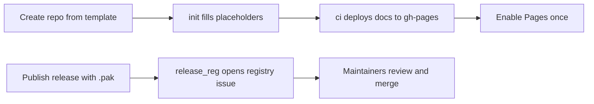

<!--
Template note: words wrapped in double underscores (NAME, DESCRIPTION, SITE_URL, REPO_URL) are placeholders.
The `Init from template` workflow replaces them (here, in mkdocs.yml, mod.json and docs/index.md)
after a repository is created from this template. Links using them only work in the new repository.
-->

# __NAME__

__DESCRIPTION__

Documentation site: [__SITE_URL__](__SITE_URL__)

---

## About this repository

This repository was created from the [ModTemplate](https://github.com/Knutschbert/ModTemplate) for **Chivalry 2** mods built with **ArgonSDK**. It combines a place for your mod's notes and documentation (published as a website via MkDocs / GitHub Pages) with the release tooling needed to submit your mod to the [C2ModRegistry](https://github.com/Chiv2-Community/C2ModRegistry).

New to modding Chivalry 2? Start with the **[ArgonSDK Field Guide](https://knutschbert.github.io/ArgonSDK-FieldGuide/)**, a community-maintained reference with tutorials, game system overviews and mod loading info.

<details>
<summary>What is in the Field Guide?</summary>

<br>

- [Requirements](https://knutschbert.github.io/ArgonSDK-FieldGuide/Tutorials/Requirements.html) and step-by-step tutorials (swapping a texture, FFA and TDM maps, your first Blueprint mod)
- Overviews of game systems: spawns, weapons, game modes and objectives
- Unchained mod loading: file lists, mod loader flags and command line arguments
- Case studies of existing mods
- The [ModTemplate page](https://knutschbert.github.io/ArgonSDK-FieldGuide/Mods/ModTemplate.html) describing this template

</details>

## Getting started

1. **Clone** this repository and build your mod following the [Field Guide](https://knutschbert.github.io/ArgonSDK-FieldGuide/).
2. **Write your docs** in the [`docs/`](__REPO_URL__/tree/main/docs) folder (see [Editing the docs](#editing-the-docs-with-obsidian)). The site is rebuilt and published by the [`ci` workflow](__REPO_URL__/actions/workflows/ci.yml) on every push to `main`.
3. **Enable GitHub Pages** once. After the first `ci` run has finished successfully (check the [Actions tab](__REPO_URL__/actions)), open the **[Pages settings](__REPO_URL__/settings/pages)**, choose **Deploy from a branch**, select the branch `gh-pages` with folder `/ (root)` and save. Your site will be available at [__SITE_URL__](__SITE_URL__) a minute later.
4. **Publish a release** (see [Releasing](#releasing)) from the [new release page](__REPO_URL__/releases/new).

> [!NOTE]
> The `gh-pages` branch only exists after the first successful `ci` run. Until then the branch list in the Pages settings is empty.

> [!TIP]
> Pages and the repository website can be set up **automatically** with a `PAGES_PAT` secret, so you can skip step 3 and the manual website setting. See [Creating the `PAGES_PAT` token](#pages-pat).

<details>
<summary>Pages not working, or want it automated? (optional)</summary>

<br>

- If the branch list in the Pages settings is empty, the first `ci` run has not succeeded yet. Check the [Actions tab](__REPO_URL__/actions), or [run the `ci` workflow by hand](__REPO_URL__/actions/workflows/ci.yml).
- When creating your repository from the template, copy only the `main` branch. The `gh-pages` branch is created for you.
- The [`ci` workflow](__REPO_URL__/actions/workflows/ci.yml) also tries to enable Pages itself on the first run, and the [`init` workflow](__REPO_URL__/actions/workflows/init.yml) sets your site as the repository website (the link in the "About" box on the [repository page](__REPO_URL__)). Both only work if you add a `PAGES_PAT` secret with a token that can administer the repository (see below). Without it, set the website under the gear icon in the "About" box of the [repository page](__REPO_URL__) by hand.

</details>

<a name="pages-pat"></a>

<details>
<summary>Creating the <code>PAGES_PAT</code> token (optional)</summary>

<br>

**1. Create the token**

Fine-grained (recommended, limited to one repository):

1. Open the [fine-grained token page](https://github.com/settings/personal-access-tokens/new) (or via your profile picture, then **Settings > Developer settings > Personal access tokens**).
2. Give it a name and an expiration. Fine-grained tokens must expire.
3. Under **Repository access**, choose **Only select repositories** and pick this repository.
4. Under **Repository permissions**, set **Administration** to **Read and write**. Metadata (read) is added automatically.
5. Click **Generate token** and copy it. GitHub shows it only once.

Classic alternative: [generate a classic token](https://github.com/settings/tokens/new), tick the `repo` scope and copy it. It works, but it is broader and covers all your repositories.

**2. Add it as a repository secret**

1. Open [Settings > Secrets and variables > Actions](__REPO_URL__/settings/secrets/actions) of this repository and click **New repository secret**.
2. Name it exactly `PAGES_PAT`, paste the token and save.

**Notes**

- `C2MODREGISTRY_PAT` (used by [Releasing](#releasing)) is a different token. Add it on the same [secrets page](__REPO_URL__/settings/secrets/actions). It needs permission to create issues in [`Chiv2-Community/C2ModRegistry`](https://github.com/Chiv2-Community/C2ModRegistry), not in your repository. Create it the same way, but it has to be able to access that repository. If a fine-grained token cannot select it, use a classic token with the `public_repo` scope.
- A secret added after the first run only takes effect on later runs. [Re-run the `ci` workflow](__REPO_URL__/actions/workflows/ci.yml) by hand, or set the website manually.
- If `init` cannot push, check that [workflow permissions](__REPO_URL__/settings/actions) are set to "Read and write permissions".
- Fine-grained tokens expire. When one does, the Pages and website steps stop working quietly, so create a new token and update the secret.

> [!WARNING]
> Treat tokens like passwords. Never commit them to the repository, only store them as repository secrets.

</details>

## Editing the docs with Obsidian

The [`docs/`](__REPO_URL__/tree/main/docs) folder is a plain Markdown folder, so you can open this repository (or just `docs/`) as a vault in [Obsidian](https://obsidian.md/) and edit your notes there. The Field Guide itself is written this way. `docs/index.md` is the homepage. It starts as a placeholder mod description, and the `Init from template` workflow fills in your mod's name, description and repository link. Just commit and push your changes, and GitHub Actions publishes them using [MkDocs](https://www.mkdocs.org/) with the [Material theme](https://squidfunk.github.io/mkdocs-material/).

<details>
<summary>Tips for writing pages</summary>

<br>

- Folders in `docs/` become sections in the site navigation, and notes become pages. The page title is the note's first-level heading.
- Obsidian-style `[[wikilinks]]` work in the published site.
- Math (LaTeX), Mermaid diagrams, task lists and footnotes are supported.
- Avoid spaces in new folder and file names, since they end up in the page URLs.
- To arrange pages manually, use the `nav` option in [`mkdocs.yml`](__REPO_URL__/blob/main/mkdocs.yml). See the [MkDocs docs](https://www.mkdocs.org/user-guide/configuration/#nav) and the [Material theme setup](https://squidfunk.github.io/mkdocs-material/setup/setting-up-navigation/).

</details>

## Releasing

Releases are submitted to the [C2ModRegistry](https://github.com/Chiv2-Community/C2ModRegistry) automatically:

1. Publish a **GitHub release** with a version tag (for example `v1.0.0`) from the [new release page](__REPO_URL__/releases/new) of this repository, and upload your `.pak` file as a release asset. Pre-releases are not submitted.

   > [!IMPORTANT]
   > The release must contain exactly one `.pak` file, and the tag must be a semantic version.

   Or use the command line (needs the [GitHub CLI](https://cli.github.com/)):

   ```sh
   gh release create v1.0.0 path/to/YourMod.pak --title "v1.0.0" --notes "First release"
   ```

2. The **Create Registry Issue** workflow ([`release_reg.yml`](__REPO_URL__/actions/workflows/release_reg.yml)) starts on its own and opens a registration issue in the registry, so the maintainers can review and merge the new version.

This requires a repository secret named `C2MODREGISTRY_PAT`, a personal access token that is allowed to create issues in `Chiv2-Community/C2ModRegistry`. Add it on the [Actions secrets page](__REPO_URL__/settings/secrets/actions), created the same way as the [`PAGES_PAT` token](#pages-pat). Without it the workflow skips the submission and shows a notice instead of failing.

<details>
<summary>How it works and what to do if it fails</summary>

<br>

- The workflow uses the registry's [`automated-publish`](https://github.com/Chiv2-Community/zero-infra-mod-registry/blob/v1/docs/plugin/release-requests.md) action, which checks the release before opening the issue.
- If the registration fails, fix the release and reply `retry` on the registry issue.
- You can also [run the workflow by hand](__REPO_URL__/actions/workflows/release_reg.yml), choosing the release tag in the "Use workflow from" dropdown.

</details>

## Workflows and secrets

| Workflow | Runs when | What it does | Needs |
|---|---|---|---|
| [`init`](__REPO_URL__/actions/workflows/init.yml) | First push to `main` | Fills in name, description and links, sets the repository website | `PAGES_PAT` (optional) |
| [`ci`](__REPO_URL__/actions/workflows/ci.yml) | Every push to `main` | Builds and deploys the docs site to `gh-pages` | `PAGES_PAT` (optional, enables Pages) |
| [`release_reg`](__REPO_URL__/actions/workflows/release_reg.yml) | A release is published | Opens a registration issue in the C2ModRegistry | `C2MODREGISTRY_PAT` |

<details>
<summary>How it fits together</summary>

<br>



</details>

## Credits

- Template: [Knutschbert/ModTemplate](https://github.com/Knutschbert/ModTemplate)
- Field Guide: [ArgonSDK-FieldGuide](https://knutschbert.github.io/ArgonSDK-FieldGuide/)
- Website scaffolding based on [jobindjohn/obsidian-publish-mkdocs](https://github.com/jobindjohn/obsidian-publish-mkdocs), built with [Material for MkDocs](https://squidfunk.github.io/mkdocs-material/)
